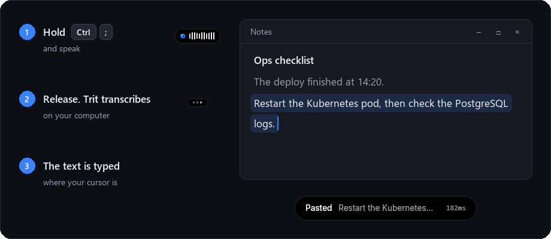
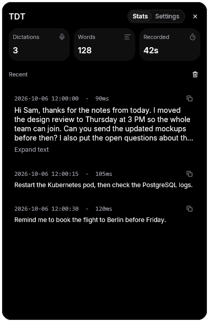
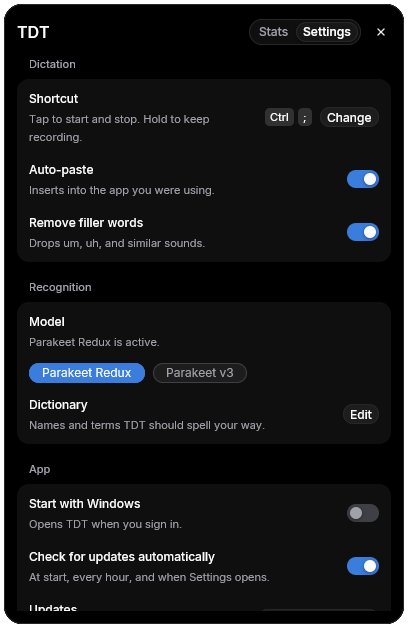

<p align="center">
  
</p>

<h1 align="center">TDT (Talk Don't Type)</h1>

<p align="center">
  <b>Offline dictation for Windows.</b> Press a key, speak, and the text appears in the app you use.<br>
  No cloud, no account, no audio leaves your computer.
</p>

<p align="center">
  <a href="https://github.com/Hi9841/tdt/releases/latest"><b>Download TDT-Setup.exe</b></a>
  ·
  <a href="https://github.com/Hi9841/trit">Trit speech engine (STT and TTS)</a>
  ·
  <a href="https://hi9841.github.io/trit/benchmarks/">Benchmarks</a>
  ·
  <a href="#license">License</a>
</p>

<p align="center">
  
</p>

## Why TDT

- **Private.** TDT records and transcribes on your computer. It uses the
  network only to download a model and to look for updates.
- **Fast.** TDT's own speech engine, [Trit](https://github.com/Hi9841/trit), is written in
  Rust. The default model loads in about 0.2 seconds and stays in memory, so a
  recording never waits for it.
- **Accurate.** The default model, Parakeet Redux, has 1.58-bit ternary
  weights and is only 178 MB. On 456 test clips it makes fewer errors than the
  same model on any other runtime that we tested.
- **Small.** TDT-Setup.exe is about 8 MB. It needs no admin rights and no
  Python.

## Install

1. Download `TDT-Setup.exe` from the
   [latest release](https://github.com/Hi9841/tdt/releases/latest).
2. Run it. Setup installs TDT for the current user in `%LOCALAPPDATA%\TDT`,
   adds a Start menu shortcut, and opens the app.
3. Open Settings and download **Parakeet Redux** (178 MB). The model stays on
   disk.

To uninstall, use Windows Settings > Apps. Uninstall keeps your speech models
and your dictionary.

## Use

| Action | How |
|---|---|
| Start and stop a recording | Tap `Ctrl + ;` once to start and once to stop. |
| Record while you hold the key | Hold `Ctrl + ;`, speak, and release. |
| Change the shortcut | Settings > **Shortcut** > **Change**, then press the new keys. |
| Open Settings | Click the tray icon. |

The floating pill at the bottom of the screen shows the state:

| Ready | Listening | Transcribing | Pasted |
|:---:|:---:|:---:|:---:|
|  |  |  |  |

The tray icon shows the same state; hover over it to see the latest
transcript. Click the tray icon to open the panel. **Stats**
keeps the full text of your recent dictations, with a copy button for each.
**Settings** has every option.

<p align="center">
  
  &nbsp;
  
</p>

With **auto-paste** on (the default), TDT types the text into the window that
had focus. TDT also copies the text to the clipboard. A recording can be up to
120 seconds long.

If the text does not appear in the app, press Ctrl+V. The pill tells you why
TDT did not type it:

- You pressed a key or a mouse button while TDT was finishing.
- The app runs as administrator. Windows does not let TDT type into it.
- TDT could not go back to the app.

TDT writes one line about each dictation to `%LOCALAPPDATA%\TDT\tdt.log`: the
app and the result, never the text.

## Settings

| Setting | What it does |
|---|---|
| Model | **Parakeet Redux** (178 MB, the default) or **Parakeet v3** (2.5 GB). |
| Remove filler words | Removes "um", "uh", "erm", and "hmm", and the commas around them. Words that can carry meaning, such as "like", stay. On by default. |
| Dictionary | Names and terms that TDT must spell your way. See [Dictionary](#dictionary). |
| Start with Windows | Opens TDT when you sign in. |
| Check for updates automatically | Looks for a new release at start, every hour, and when Settings opens. Turn it off to check only when you select **Check for updates**. |

## Dictionary

TDT spells names and technical terms better when they are in your dictionary.
TDT ships no word lists: the dictionary holds only the words you add.

To add your own words:

1. Open Settings and find **Dictionary**.
2. Select **Edit**. TDT opens `%LOCALAPPDATA%\TDT\dictionary.txt`.
3. Write one word or name on each line, spelled the way you want it.
4. Save the file. The next dictation uses it.

After each dictation, TDT looks for words that are spelled close to a term
("Perakeet", "trip run time", "wire shark"). The speech model then scores
the words it heard and the term on the same audio. TDT writes the term only
when the audio supports it, so "the mayor" stays "the mayor" when Maor is in
the dictionary. Words with the same letters as a term sound the same, so
the audio cannot decide between them. They always become the term when the
term has inner capitals ("web socket" for WebSocket), or when letters after
the first differ in case ("PNPM" for pnpm).

On test sentences with names and product names, with those names in the
dictionary, TDT writes 31 of 37 names correctly; without them, 11.

TDT writes English only. It never writes word pieces with letters that
English does not use (accents, Cyrillic, Greek).

## Benchmarks

The same models on Trit and on the other CPU runtimes, with the same 456
clips: LibriSpeech test-clean (200), test-other (200), developer terms (40),
and everyday dictation (16). AMD Ryzen 9 7950X3D, Windows 11.

<p align="center">
  
</p>

<p align="center">
  
</p>

For each model, Trit makes the fewest errors or ties for the fewest, and it
has the shortest time per clip. The runtimes are faster-whisper, whisper.cpp,
ONNX Runtime, sherpa-onnx, Transformers, OpenAI Whisper, and Photon. The full
tables, memory use, the text cleanup model, and the method are in
[Trit's engine comparison](https://github.com/Hi9841/trit/blob/main/docs/engine-comparison.md). The
commands that reproduce them are in [Trit's bench folder](https://github.com/Hi9841/trit/tree/main/bench).
TDT's own ratchet (the same Parakeet Redux numbers through the app's engine
path) is in [desktop/bench](desktop/bench/README.md).

Trit also speaks text (text to speech): Kokoro-82M with 28 English voices
(American and British; it reads numbers, money, times, and symbols), and
the Meta MMS-TTS voice. Use `trit speak "<text>" --voice bf_emma`, or `Voice`
in Rust, C, Python, C#, and Node. The TDT app does not use it yet. Spoken by
Trit and by the `kokoro` package, then transcribed by Parakeet Redux, 56
test sentences give 70 word errors with Trit and 70 to 71 with the
reference. The speech-to-text results above did not change: the 440
LibriSpeech and tech transcripts are the same as in 0.4.12. See
[Text to speech](https://github.com/Hi9841/trit#text-to-speech).

## Updates

When a newer version is available, Settings shows **Update now**. One click
downloads `TDT-Setup.exe` from GitHub, verifies its size and its SHA-256
digest, and runs it silently. Setup replaces TDT.exe and opens the new
version. Your speech models and settings stay.

## Privacy

Recording and transcription stay on your computer. TDT uses the network only
for these operations:

- The model download that you start in Settings.
- The update check. It connects only to GitHub.

## Build from source

You need Rust stable on Windows.

```powershell
cargo run --release --bin download-model --manifest-path .\desktop\Cargo.toml
cargo run --release --bin TDT --manifest-path .\desktop\Cargo.toml
```

`download-model` gets Parakeet Redux the same way Settings does, with a
SHA-256 check of each file. It needs no PowerShell script. Add
`-- parakeet-tdt-0.6b-v3` for Parakeet v3.

Checks before a change:

```powershell
cargo fmt --manifest-path .\desktop\Cargo.toml -- --check
cargo clippy --manifest-path .\desktop\Cargo.toml --all-targets --all-features -- -D warnings
```

To build `dist\TDT-Setup.exe`:

```powershell
powershell -ExecutionPolicy Bypass -File .\packaging\build-installer.ps1
```

To publish a release, set the version in `desktop/Cargo.toml` and push a
matching tag, such as `v0.4.0`. The `Release` workflow builds `TDT-Setup.exe`
and attaches it with `SHA256SUMS.txt`. TDT 0.2.32 and older need
`SHA256SUMS.txt` to find the update.

## Repository layout

| Folder | Contents |
|---|---|
| `desktop/` | The Windows app (Rust and GPUI) and the speech benchmark. |
| `packaging/` | `TDT-Setup.exe` (install, update, uninstall) and its build script. |
| `docs/` | The README images. `docs/images/capture.py` captures the app pictures again. |
| `site/` | The TDT website. |

Trit, the speech engine (speech to text and text to speech), has its own
repository: [Hi9841/trit](https://github.com/Hi9841/trit), with its website at
<https://hi9841.github.io/trit/>. TDT uses a tagged version of it
(`desktop/Cargo.toml`). To build TDT with a local Trit checkout:

```powershell
cargo build --release --manifest-path .\desktop\Cargo.toml --config "patch.'https://github.com/Hi9841/trit'.trit.path='..\trit'"
```

## License

TDT and Trit are under the [PolyForm Noncommercial License 1.0.0](LICENSE).
You can use, change, and share them for any noncommercial purpose. You cannot
sell them or use them to make money. Versions 0.3.2 and older were released
under Apache-2.0 and stay under that license.

Model weights and third-party code have their own licenses. Read
[THIRD_PARTY_NOTICES.md](THIRD_PARTY_NOTICES.md) before you share them.
