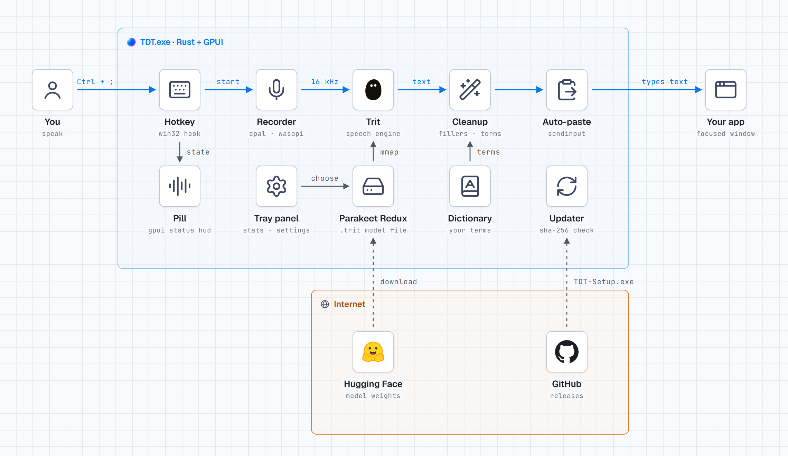
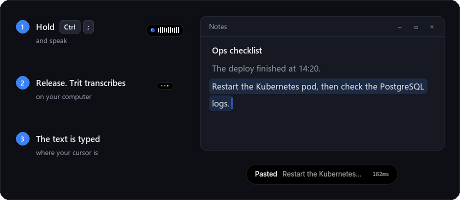
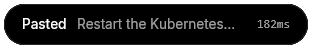
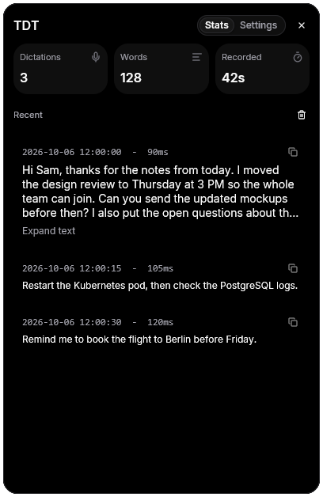
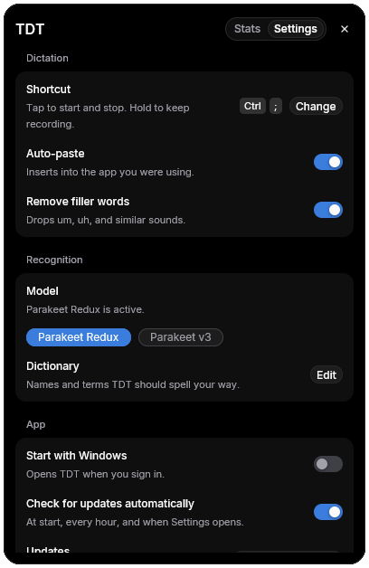

<p align="center">
  
</p>

<h1 align="center">TDT (Talk Don't Type)</h1>

<p align="center">
  <b>Offline dictation for Windows.</b> Press a key, speak, and the text appears in the app you use.<br>
  No cloud, no account, no audio leaves your computer.
</p>

<p align="center">
  <a href="https://github.com/Hi9841/tdt/releases/latest"><b>Download TDT-Setup.exe</b></a>
  ·
  <a href="https://github.com/Hi9841/trit">Trit speech engine</a>
  ·
  <a href="https://hi9841.github.io/trit/benchmarks/">Benchmarks</a>
  ·
  <a href="#license">License</a>
</p>

<p align="center">
  
</p>

## Why TDT

- **Private.** TDT records and transcribes on your computer. It uses the
  network only to download a model and to look for updates.
- **Fast.** [Trit](https://github.com/Hi9841/trit), TDT's own speech engine,
  is written in Rust. The model loads in about 0.2 seconds and stays in
  memory, so a recording never waits for it.
- **Accurate.** The default model, Parakeet Redux (178 MB, 1.58-bit ternary
  weights), makes fewer errors on 456 test clips than the same model on any
  other runtime that we tested.
- **Small.** TDT-Setup.exe is about 8 MB. It needs no admin rights and no
  Python.

## Install

1. Download `TDT-Setup.exe` from the
   [latest release](https://github.com/Hi9841/tdt/releases/latest) and run it.
   Setup installs TDT for the current user and opens it.
2. Open Settings and download **Parakeet Redux** (178 MB).

To uninstall, use Windows Settings > Apps. Your models and your dictionary
stay.

## Use

<p align="center">
  
</p>

| Action | How |
|---|---|
| Start and stop a recording | Tap `Ctrl + ;` once to start and once to stop. |
| Record while you hold the key | Hold `Ctrl + ;`, speak, and release. |
| Change the shortcut | Settings > **Shortcut** > **Change**, then press the new keys or a side mouse button. |
| Open Stats and Settings | Click the tray icon. |

TDT types the text into the window that had focus and copies it to the
clipboard. A recording can be up to 120 seconds long. If the text does not
appear, press Ctrl+V; the pill tells you why. For example, Windows does not
let TDT type into an app that runs as administrator.

The time on the pill and in History is the wait you feel: from the moment you
ask to stop (you release a hold, or press the key for a tap) until the text is
in your app. `%LOCALAPPDATA%\TDT\tdt.log` splits each wait into three parts:
the end of your last word, the model, and the delivery.

| Ready | Listening | Transcribing | Pasted |
|:---:|:---:|:---:|:---:|
|  |  |  |  |

<p align="center">
  
  &nbsp;
  
</p>

## Settings

| Setting | What it does |
|---|---|
| Model | **Parakeet Redux** (178 MB, the default) or **Parakeet Ultra** (1.3 GB). Ultra makes about a third fewer errors on real dictation and uses about 0.45 GB more memory. |
| Remove filler words | Removes "um", "uh", "erm", and "hmm". Words that can carry meaning, such as "like", stay. On by default. |
| Dictionary | Names and terms that TDT must spell your way. See [Dictionary](#dictionary). |
| Start with Windows | Opens TDT when you sign in. |
| Check for updates automatically | Looks for a new release at start and every hour. **Update now** downloads the new setup from GitHub, checks its SHA-256 digest, and installs it. |

## Dictionary

Select **Edit** next to **Dictionary** in Settings. TDT opens
`%LOCALAPPDATA%\TDT\dictionary.txt`. Write one word or name on each line,
spelled the way you want it, and save. The next dictation uses it.

TDT replaces words that are spelled close to a term ("Perakeet", "wire
shark") only when the audio supports the term, so "the mayor" stays "the
mayor" when Maor is in the dictionary. With the names in the dictionary, TDT
writes 31 of 37 names in our test sentences correctly; without them, 11.

## Benchmarks

The same models on Trit and on the other CPU runtimes, with the same 456
clips. AMD Ryzen 9 7950X3D, Windows 11.

<p align="center">
  
</p>

<p align="center">
  
</p>

For each model, Trit makes the fewest errors or ties for the fewest, and it
has the shortest time per clip. The full tables and the method are in
[Trit's engine comparison](https://github.com/Hi9841/trit/blob/main/docs/engine-comparison.md).

## Build from source

You need Rust stable on Windows.

```powershell
cargo run --release --bin download-model --manifest-path .\desktop\Cargo.toml
cargo run --release --bin TDT --manifest-path .\desktop\Cargo.toml
```

The checks, the installer build, the release steps, and the layout of the
repository are in [CONTRIBUTING.md](CONTRIBUTING.md).

## License

TDT and Trit are under the [PolyForm Noncommercial License 1.0.0](LICENSE).
You can use, change, and share them for any noncommercial purpose. You cannot
sell them or use them to make money. Versions 0.3.2 and older were released
under Apache-2.0 and stay under that license.

Model weights and third-party code have their own licenses. Read
[THIRD_PARTY_NOTICES.md](THIRD_PARTY_NOTICES.md) before you share them.
