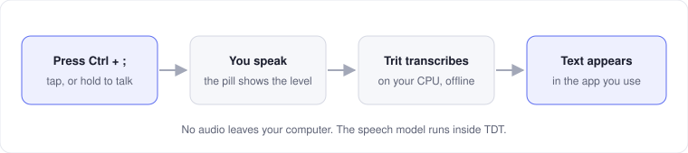
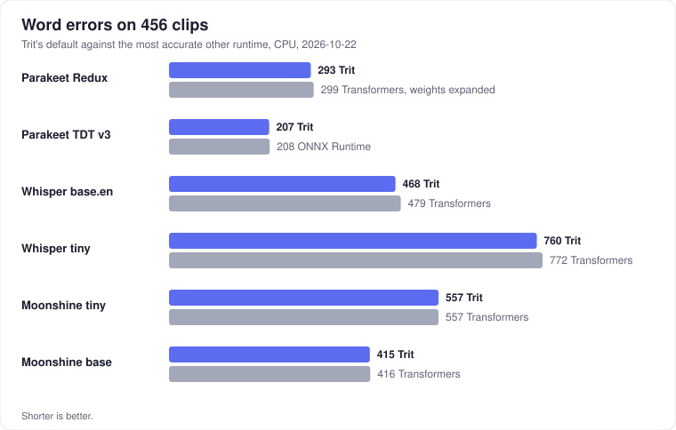
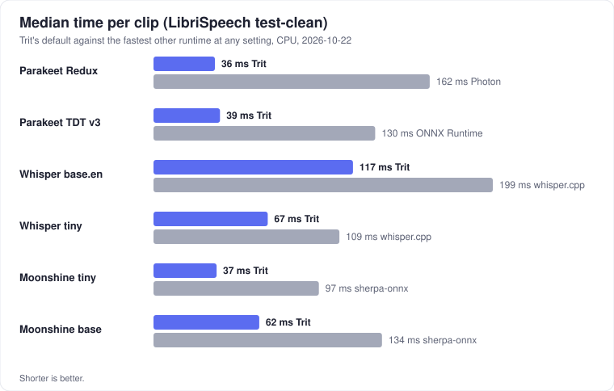

<p align="center">
  
</p>

<h1 align="center">TDT (Talk Don't Type)</h1>

<p align="center">
  <b>Offline dictation for Windows.</b> Press a key, speak, and the text appears in the app you use.<br>
  No cloud, no account, no audio leaves your computer.
</p>

<p align="center">
  <a href="https://github.com/Hi9841/tdt/releases/latest"><b>Download TDT-Setup.exe</b></a>
  ·
  <a href="trit/README.md">Trit speech engine</a>
  ·
  <a href="docs/engine-comparison.md">Benchmarks</a>
  ·
  <a href="#license">License</a>
</p>

<p align="center">
  
</p>

## Why TDT

- **Private.** TDT records and transcribes on your computer. It uses the
  network only to download a model and to look for updates.
- **Fast.** TDT's own speech engine, [Trit](trit/README.md), is written in
  Rust. The default model loads in about 0.2 seconds and stays in memory, so a
  recording never waits for it.
- **Accurate.** The default model, Parakeet Redux, has 1.58-bit ternary
  weights and is only 178 MB. On 456 test clips it makes fewer errors than the
  same model on any other runtime that we tested.
- **Small.** TDT-Setup.exe is about 8 MB. It needs no admin rights and no
  Python.

## Install

1. Download `TDT-Setup.exe` from the
   [latest release](https://github.com/Hi9841/tdt/releases/latest).
2. Run it. Setup installs TDT for the current user in `%LOCALAPPDATA%\TDT`,
   adds a Start menu shortcut, and opens the app.
3. Open Settings and download **Parakeet Redux** (178 MB). The model stays on
   disk.

To uninstall, use Windows Settings > Apps. Uninstall keeps your speech models
and your dictionary.

## Use

| Action | How |
|---|---|
| Start and stop a recording | Tap `Ctrl + ;` once to start and once to stop. |
| Record while you hold the key | Hold `Ctrl + ;`, speak, and release. |
| Change the shortcut | Settings > **Shortcut** > **Change**, then press the new keys. |
| Open Settings | Click the tray icon. |

The floating pill shows the recording state. The tray icon shows the same
state; hover over it to see the latest transcript. **History** keeps the full
text of your recent dictations.

With **auto-paste** on (the default), TDT types the text into the window that
had focus. TDT also copies the text to the clipboard. A recording can be up to
120 seconds long.

## Settings

| Setting | What it does |
|---|---|
| Model | **Parakeet Redux** (178 MB, the default) or **Parakeet v3** (2.5 GB). |
| Remove filler words | Removes "um", "uh", "erm", and "hmm", and the commas around them. Words that can carry meaning, such as "like", stay. On by default. |
| Dictionary | Names and terms that TDT must spell your way. See [Dictionary](#dictionary). |
| Start with Windows | Opens TDT when you sign in. |
| Check for updates automatically | Looks for a new release at start, every hour, and when Settings opens. Turn it off to check only when you select **Check for updates**. |

## Dictionary

TDT spells names and technical terms better when they are in its dictionary.
A list of about 130 developer terms, for example Kubernetes, PostgreSQL, and
GitHub, is always active.

To add your own words:

1. Open Settings and find **Dictionary**.
2. Select **Edit**. TDT opens `%LOCALAPPDATA%\TDT\dictionary.txt`.
3. Write one word or name on each line, spelled the way you want it.
4. Save the file. The next dictation uses it.

TDT changes a word only when the speech supports it. On the test sentences
with developer terms, the dictionary removes about a third of the errors. On
400 recordings of ordinary speech (LibriSpeech), it changes no transcript.

## Benchmarks

The same models on Trit and on the other CPU runtimes, with the same 456
clips: LibriSpeech test-clean (200), test-other (200), developer terms (40),
and everyday dictation (16). AMD Ryzen 9 7950X3D, Windows 11.

<p align="center">
  
</p>

<p align="center">
  
</p>

For each model, Trit makes the fewest errors or ties for the fewest, and it
has the shortest time per clip. The runtimes are faster-whisper, whisper.cpp,
ONNX Runtime, sherpa-onnx, Transformers, OpenAI Whisper, and Photon. The full
tables, memory use, the text cleanup model, and the method are in
[docs/engine-comparison.md](docs/engine-comparison.md). The commands that
reproduce them are in [desktop/bench](desktop/bench/README.md).

## Updates

When a newer version is available, Settings shows **Update now**. One click
downloads `TDT-Setup.exe` from GitHub, verifies its size and its SHA-256
digest, and runs it silently. Setup replaces TDT.exe and opens the new
version. Your speech models and settings stay.

## Privacy

Recording and transcription stay on your computer. TDT uses the network only
for these operations:

- The model download that you start in Settings.
- The update check. It connects only to GitHub.

## Build from source

You need Rust stable on Windows.

```powershell
powershell -ExecutionPolicy Bypass -File .\models\download-models.ps1
cargo run --release --bin TDT --manifest-path .\desktop\Cargo.toml
```

Checks before a change:

```powershell
cargo fmt --manifest-path .\desktop\Cargo.toml -- --check
cargo clippy --manifest-path .\desktop\Cargo.toml --all-targets --all-features -- -D warnings
```

To build `dist\TDT-Setup.exe`:

```powershell
powershell -ExecutionPolicy Bypass -File .\packaging\build-installer.ps1
```

To publish a release, set the version in `desktop/Cargo.toml` and push a
matching tag, such as `v0.4.0`. The `Release` workflow builds `TDT-Setup.exe`
and attaches it with `SHA256SUMS.txt`. TDT 0.2.32 and older need
`SHA256SUMS.txt` to find the update.

## Repository layout

| Folder | Contents |
|---|---|
| `desktop/` | The Windows app (Rust and GPUI) and the speech benchmark. |
| `trit/` | Trit, the speech engine: a Rust crate, a CLI, a C ABI, and Python, C#, and Node bindings. |
| `models/` | The model downloader. |
| `packaging/` | `TDT-Setup.exe` (install, update, uninstall) and its build script. |
| `docs/` | The engine comparison and the README images. |
| `site/` | The TDT website. |

## License

TDT and Trit are under the [PolyForm Noncommercial License 1.0.0](LICENSE).
You can use, change, and share them for any noncommercial purpose. You cannot
sell them or use them to make money. Versions 0.3.2 and older were released
under Apache-2.0 and stay under that license.

Model weights and third-party code have their own licenses. Read
[THIRD_PARTY_NOTICES.md](THIRD_PARTY_NOTICES.md) before you share them.
